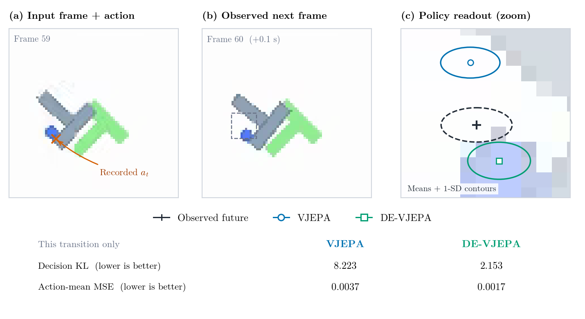

# DE-VJEPA

**Decision-Equivalent Latent Prediction for Policy Fidelity and Control**

[Read the paper](paper/DE-VJEPA.pdf) · [Download the editable source and supplement](paper/DE-VJEPA_source.zip) · [Manuscript details](paper/README.md)

DE-VJEPA studies whether a frozen policy can supply an action-relevant loss
for latent prediction. A policy-KL penalty compares the action distributions
at observed and predicted future latents. The central finding is that latent
accuracy, policy fidelity, and control success can favor different models.

The current manuscript uses the TMLR review format: **12 pages of main
content**, with references starting on page 13. The complete PDF has 36 pages,
including references and appendices.

## Released implementation

The released prediction path is **deterministic, with auxiliary input
`h=0`**, during both training and evaluation. Its target-conditioned
posterior branch receives a separate KL regularizer; posterior samples do
not enter the prediction or policy loss. The task embedding is shared.

The manuscript equation, Figure 2, and training algorithm describe that
implementation. `VJEPA`, `DE-VJEPA`, `BJEPA`, and `DE-BJEPA` remain the original
result labels for traceability. These labels do not establish optimization
of the full Variational JEPA bound or learned stochastic uncertainty.

## Findings and evidence

- On clean MetaWorld, DE-VJEPA has **15.4% higher latent MSE** and **19.8%
  lower decision KL** than the latent-only baseline, reversing their ranking.
- Decision KL improves in **seven of eight dataset–condition comparisons**.
  Persistence remains a stronger baseline on clean PushT.
- The **14,850 closed-loop MetaWorld episodes do not establish an aggregate
  success advantage** over latent-only prediction with the tested planners.
- The original **53 compact result CSVs are unchanged**. Shared models and
  evaluators limit the interpretation of the nominal statistical tests.

The original release bundles code, configurations, and compact results, and
their checksums have been verified. Original run logs, checkpoints, and
run-level source identifiers were not recovered, so release association
does not verify the exact code executed for each historical run. The paper
discloses this limit and does not claim an independent reproduction of the
original aggregate experiments.

## A real PushT transition



This worked example uses actual RGB frames and model outputs from a
**separate illustrative rerun**, with source seed 42 and evaluator seed 1000.
Episode 7 is held out under both seeds, and frames 59–60 were selected from
recorded object motion before training. The readouts show the same BC policy
at the observed and predicted future latents. They are action distributions,
not decoded future images. These single-transition values are separate from
the original aggregate comparisons.

## Repository contents

| Location | Contents |
| --- | --- |
| [`paper/`](paper/) | Current PDF, self-contained source/supplement ZIP, metadata, and checksums |
| [`src/devjepa/`](src/devjepa/) | Original model, loss, training, and evaluation implementation |
| [`configs/`](configs/) | Original experiment configurations |
| [`scripts/`](scripts/) | Original experiment launchers and analysis scripts |
| [`tests/`](tests/) | Original unit tests |
| [`results/`](results/) | Original compact summaries, paired comparisons, statistics, and manifests |
| [`tables/`](tables/) and [`plots/`](plots/) | Original release-derived artifacts; revised manuscript figures are in the source ZIP |
| [`tools/audit_training_path.py`](tools/audit_training_path.py) | Source-integrity and gradient-dependency audit, with no training |
| [`tools/verify_paper.py`](tools/verify_paper.py) | Current paper/supplement integrity and page-count checks |

Large datasets, raw per-sample/episode outputs, and checkpoints are excluded
from Git. The source bundle includes the saved frames and policy outputs
needed to rebuild the worked-example figure without retraining.

## Verify without running experiments

Use Python 3.10–3.12. For the two audits, install the lightweight dependencies
and a PyTorch build appropriate for your machine:

```bash
python -m pip install torch numpy PyYAML tqdm pypdf
python tools/audit_training_path.py
python tools/verify_paper.py
```

The first audit verifies 87 released code/configuration/script/test files and
checks which losses reach the posterior and predictor using synthetic tensors.
It takes **zero optimizer steps**. The second checks the PDF and source ZIP,
all 53 original result CSVs, and the regular-length manuscript boundary.
Neither audit reproduces the historical experimental results.

For the full experimental environment on Linux/WSL2:

```bash
python -m venv .venv
source .venv/bin/activate
python -m pip install --upgrade pip
python -m pip install -e ".[dev]"
pytest -q
```

The original CUDA workflows are configured for Linux/WSL2. The source ZIP's
`implementation/README.txt` describes the released loss paths and provenance.
Record the environment, data hashes, source revision, and generated checkpoint
hashes for any new experimental rerun, and keep its outputs separate from the
tracked original summaries.

## Licensing

The original experimental release does not assign a repository-wide software
or dataset license. The manuscript source bundle preserves the included TMLR
template and font licenses. Dataset and pretrained-backbone terms are separate.
